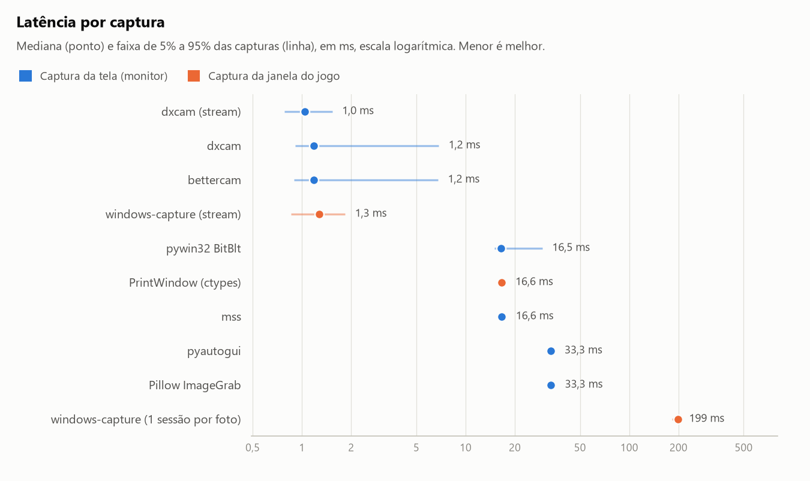
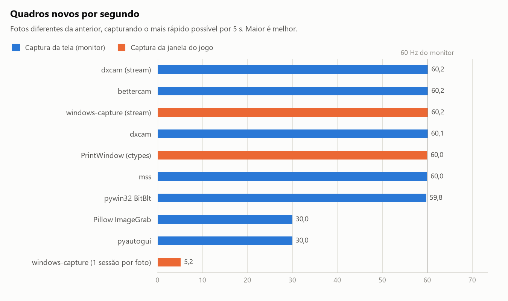
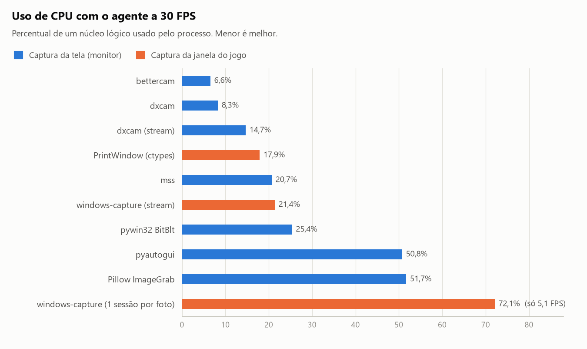
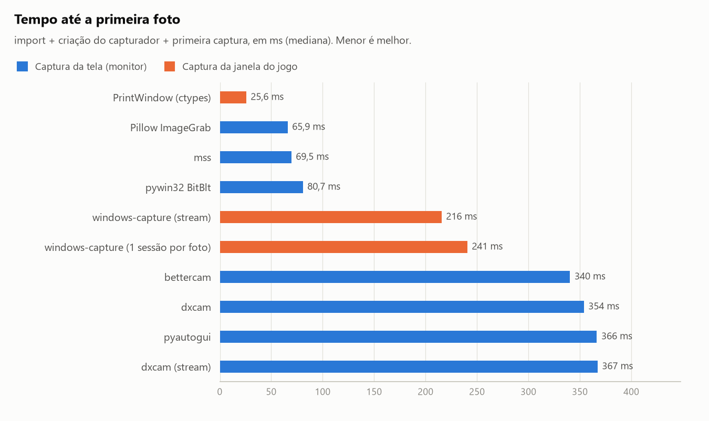
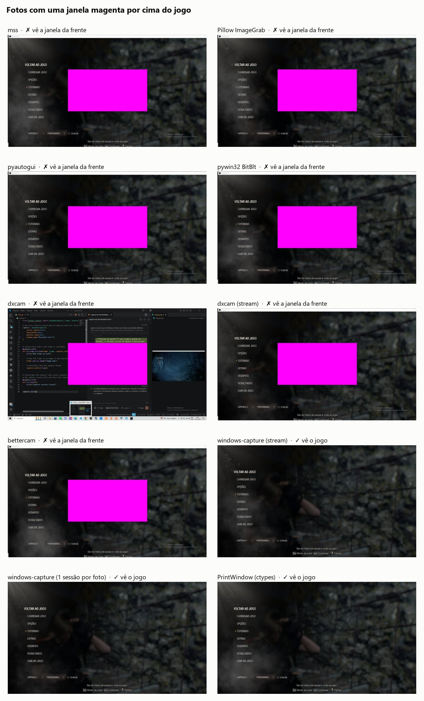
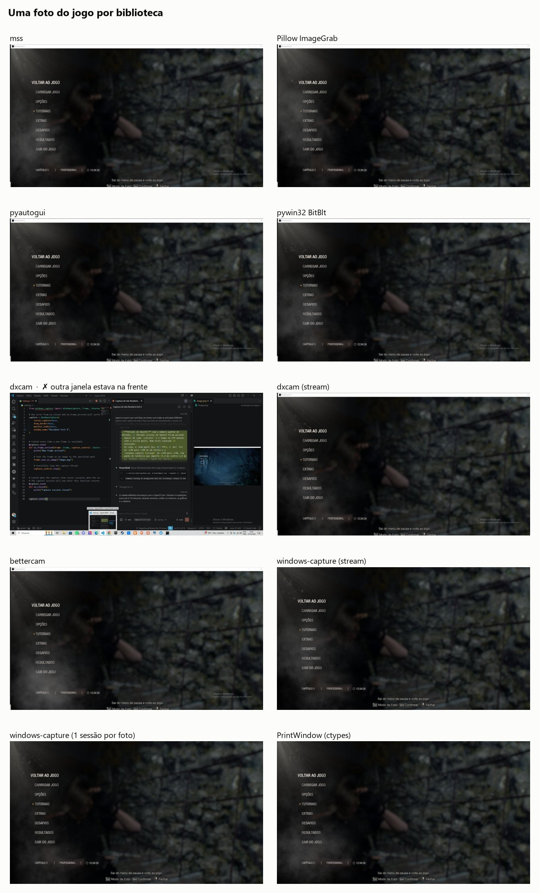

# Benchmark de captura de tela: Resident Evil 4 Remake

Comparação das principais bibliotecas Python para capturar a tela do jogo no Windows, medida
com o jogo rodando de verdade. Gerado automaticamente por `python -m benchmark.run` em 27/10/2026 22:48
(10 configurações, 4 repetições de 5 s cada).

## Resumo

- **Mais rápidas por captura:** `dxcam (stream)`, `dxcam`, `bettercam`, `windows-capture (stream)`, todas entre 1,0 e 1,3 ms (mediana). A mais lenta, `windows-capture (1 sessão por foto)`, levou 199 ms.
- **Menor uso de CPU no cenário do agente:** `bettercam`, 6,6% de um núcleo.
- **Receberam todos os quadros do jogo (~60 por segundo):** `mss`, `pywin32 BitBlt`, `dxcam`, `dxcam (stream)`, `bettercam`, `windows-capture (stream)`, `PrintWindow (ctypes)`.
- **Continuam vendo o jogo quando outra janela fica por cima:** `windows-capture (stream)`, `windows-capture (1 sessão por foto)`, `PrintWindow (ctypes)`. Todas as outras fotografam o que está na frente.
- **Inicialização mais rápida:** `PrintWindow (ctypes)`, 25,6 ms até a primeira foto.

## Escolha do Agent RED4: `windows-capture (stream)`

Comparação das finalistas: a escolhida, a outra captura de janela que aguenta o agente, o jeito
original do `main.py` e a captura de tela mais barata.

|  | `windows-capture (stream)` **(escolhida)** | `PrintWindow (ctypes)` | `windows-capture (1 sessão por foto)` | `bettercam` |
| :--- | ---: | ---: | ---: | ---: |
| **Captura** | janela | janela | janela | tela |
| **Vê o jogo com outra janela na frente** | ✅ 4/4 | ✅ 4/4 | ✅ 4/4 | ❌ 0/4 |
| **Tempo por foto (mediana)** | 1,3 ms | 16,6 ms | 199 ms | 1,2 ms |
| **Quadros novos por segundo** | 60,2 | 60,0 | 5,2 | 60,2 |
| **CPU a 30 FPS** | 21,4% | 17,9% | 72,1% | 6,6% |
| **CPU a 60 FPS (gravação)** | 31,2% | 39,6% | não medido | não medido |
| **Tempo por foto a 60 FPS** | 2,0 ms | 15,1 ms | não medido | não medido |
| **Memória extra** | 52 MB | 14 MB | 506 MB | 48 MB |
| **Até a primeira foto** | 216 ms | 25,6 ms | 241 ms | 340 ms |

### Por que ela

- **Enxerga o jogo mesmo com outra janela na frente.** Só as capturas de janela (`windows-capture (stream)`, `windows-capture (1 sessão por foto)`, `PrintWindow (ctypes)`) passaram nesse teste em todas as execuções; as 7 capturas de tela fotografaram a janela que estava por cima. Durante o próprio benchmark, `dxcam` chegou a fotografar outra janela que foi para a frente do jogo.
- **Não trava o agente.** Cada foto leva 1,3 ms, contra 16,6 ms do `PrintWindow (ctypes)` (13× mais). O `PrintWindow (ctypes)` espera o Windows desenhar a janela a cada chamada; a `windows-capture (stream)` recebe os quadros numa thread própria e o agente só copia o último. A 30 FPS, o `PrintWindow (ctypes)` deixaria o agente parado 50% do tempo.
- **Acompanha o jogo inteiro.** Recebeu 60,2 quadros novos por segundo, o máximo que o monitor de 60 Hz mostra.
- **É a mais barata para gravar dados de treino a 60 FPS.** 31,2% de CPU contra 39,6% do `PrintWindow (ctypes)` (5,2 contra 6,6 ms de CPU por foto). Nesse ritmo o `PrintWindow (ctypes)` fica 15,1 ms parado em cada quadro de 16,7 ms; a `windows-capture (stream)`, 2,0 ms.
- **Com a sessão aberta, e não uma por foto.** O jeito do `main.py` original (`windows-capture (1 sessão por foto)`) levou 199 ms por foto, 156× mais que a sessão contínua, e não passou de 5,2 fotos por segundo. A memória ainda cresceu 506 MB, contra 52 MB.

### O que se paga por ela

- A 30 FPS gasta mais CPU que o `PrintWindow (ctypes)` (21,4% contra 17,9%), porque no Windows 10 a sessão recebe todos os quadros do jogo mesmo que o agente use só parte deles (`minimum_update_interval` não é suportado). Gravando a 60 FPS, esse trabalho deixa de ser desperdício.
- Demora 216 ms para entregar a primeira foto (25,6 ms no `PrintWindow (ctypes)`). Só acontece uma vez, ao abrir a sessão.
- Usa mais memória: 52 MB contra 14 MB.
- No Windows 10 desenha uma borda amarela em volta da janela do jogo enquanto captura.
- Se o jogo ficasse sempre na frente, `bettercam` gastaria menos CPU (6,6%). Mas ela fotografa o monitor: qualquer janela, notificação ou a barra de tarefas por cima do jogo entraria nas imagens do dataset.

### Como usar sem perder desempenho

- Abra a sessão uma vez e mantenha aberta enquanto o agente roda (é o que o `capturers.py` da raiz faz).
- Dentro do `on_frame_arrived`, copie o quadro só com numpy: chamar o OpenCV ali derruba o processo na próxima sessão de captura.
- Chame `cv2.setNumThreads(1)` no início do programa: o pool ocioso do OpenCV quase dobra o uso de CPU (veja as observações).
- Para gravar dataset, consuma cada quadro no próprio callback (numa fila, junto com `frame.timespan`) em vez de ler o último a 60 Hz: lendo o último, uma das execuções a 60 FPS pegou só 41,6 quadros diferentes por segundo.
- Nunca minimize o jogo. Atrás de outras janelas funciona normalmente.

## Ambiente

| Item | Valor |
| :--- | :--- |
| Sistema | Windows 10 (build 10.0.19045) |
| Processador | AMD Ryzen 5 5600XT 6-Core Processor (6 núcleos, 12 threads) |
| Placa de vídeo | NVIDIA GeForce RTX 5060 |
| Memória | 15,9 GB |
| Monitor | 1920x1080 a 60 Hz |
| Jogo | Resident Evil 4, modo janela, imagem de 1920x1080 na posição (8, 31) |
| Python | 3.14.6 |
| numpy / OpenCV | 2.5.4 / 5.0.0.93 |

## O que foi testado

| Opção | Pacote | API do Windows | Captura | Como foi usada |
| :--- | :--- | :--- | :--- | :--- |
| `mss` | mss 10.2.0 | GDI BitBlt | tela | Cópia do monitor a cada chamada |
| `Pillow ImageGrab` | pillow 13.0.0 | GDI BitBlt | tela | Cópia do monitor a cada chamada |
| `pyautogui` | pyautogui 0.9.54 | GDI BitBlt (via Pillow) | tela | Cópia do monitor a cada chamada |
| `pywin32 BitBlt` | pywin32 312 | GDI BitBlt | tela | Cópia do monitor a cada chamada |
| `dxcam` | dxcam 0.3.0 | DXGI Desktop Duplication | tela | grab() sob demanda; repete o último quadro se a tela não mudou |
| `dxcam (stream)` | dxcam 0.3.0 | DXGI Desktop Duplication | tela | Thread interna a 60 FPS; grab() lê o quadro mais recente |
| `bettercam` | bettercam 1.0.0 | DXGI Desktop Duplication | tela | grab() sob demanda; repete o último quadro se a tela não mudou |
| `windows-capture (stream)` | windows-capture 2.0.1 | Windows Graphics Capture | janela | Sessão contínua; grab() lê o quadro mais recente |
| `windows-capture (1 sessão por foto)` | windows-capture 2.0.1 | Windows Graphics Capture | janela | Abre uma sessão, espera 1 quadro e fecha (como o main.py) |
| `PrintWindow (ctypes)` | nenhum (ctypes) | PrintWindow (PW_RENDERFULLCONTENT) | janela | Pede ao Windows o conteúdo atual da janela |

Por baixo, são só quatro tecnologias do Windows:

- **GDI BitBlt** (`mss`, `Pillow`, `pyautogui`, `pywin32`): o processador copia os pixels do monitor a
  cada chamada. Simples e universal, mas copiar 1920x1080 pela CPU é caro.
- **DXGI Desktop Duplication** (`dxcam`, `bettercam`): a placa de vídeo entrega a imagem pronta do
  monitor, e só quando ela muda. Muito barato, mas também só vê o que está na tela.
- **Windows Graphics Capture** (`windows-capture`): o compositor do Windows entrega a imagem da
  própria janela do jogo, mesmo coberta por outras. Não funciona com a janela minimizada.
- **PrintWindow com `PW_RENDERFULLCONTENT`**: pede ao Windows o conteúdo atual da janela. Também
  funciona com ela coberta; só precisa de `ctypes` (nenhum pacote extra).

## Metodologia

- **Mesmo contrato para todas:** cada captura devolve um `numpy.ndarray` (altura x largura x 3, BGR,
  `uint8`) que pertence a quem chamou, pronto para o OpenCV. O tempo de conversão para esse formato
  está incluído. As de tela capturam o monitor inteiro (1920x1080); as de
  janela, a imagem do jogo (1920x1080), a mesma quantidade de pixels.
  Na conversão de cores, o OpenCV foi limitado a 1 thread em todas as execuções (`cv2.setNumThreads`), para que o pool ocioso dele não distorça a CPU medida.
- **Uso correto de cada biblioteca:** objetos, contextos de dispositivo e buffers são criados uma vez e
  reaproveitados. `dxcam`/`bettercam` devolvem o último quadro quando a tela não mudou, que é o que um
  agente precisa (a imagem atual).
- **Isolamento:** cada biblioteca roda em um processo Python novo, então o custo de import, objetos
  globais e recursos de uma não afetam a outra. As repetições alternam a ordem de execução.
- **Testes de cada execução:**
  1. *Inicialização:* tempo de `import`, de criar o capturador e da primeira foto.
  2. *Velocidade máxima* (5 s): captura em laço, sem pausa. Mede a latência
     de cada chamada, chamadas por segundo e **quadros novos por segundo** (fotos diferentes da anterior,
     o que mostra se a biblioteca acompanha o jogo ou só repete a mesma imagem).
  3. *Cenário do agente* (5 s): captura a 30 FPS, como um
     agente faria, e mede o uso de CPU do processo (100% = um núcleo lógico inteiro).
  4. *Mostra o jogo?* Compara a foto com o conteúdo da janela do jogo naquele instante.
  5. *Jogo coberto:* abre uma janela magenta sempre no topo sobre o centro do jogo e verifica se ela
     aparece na foto.
- Antes de cada execução o jogo é trazido para a frente **sem receber o foco**, para que as capturas de
  tela vejam o jogo.

## Resultados

### Latência por captura



| Opção | Mediana (ms) | 5% (ms) | 95% (ms) | Chamadas/s | Quadros novos/s |
| :--- | ---: | ---: | ---: | ---: | ---: |
| `dxcam (stream)` | 1,0 | 0,78 | 1,5 | 911,9 | 60,2 |
| `dxcam` | 1,2 | 0,91 | 6,8 | 532,7 | 60,1 |
| `bettercam` | 1,2 | 0,90 | 6,8 | 550,5 | 60,2 |
| `windows-capture (stream)` | 1,3 | 0,85 | 1,8 | 738,7 | 60,2 |
| `pywin32 BitBlt` | 16,5 | 14,9 | 29,4 | 59,8 | 59,8 |
| `PrintWindow (ctypes)` | 16,6 | 15,7 | 17,5 | 60,0 | 60,0 |
| `mss` | 16,6 | 15,7 | 17,6 | 60,0 | 60,0 |
| `pyautogui` | 33,3 | 31,7 | 35,0 | 30,0 | 30,0 |
| `Pillow ImageGrab` | 33,3 | 31,3 | 35,2 | 30,0 | 30,0 |
| `windows-capture (1 sessão por foto)` | 199 | 183 | 202 | 5,2 | 5,2 |

"Chamadas/s" é quantas vezes a função retornou por segundo; "Quadros novos/s" é quantas dessas fotos
eram diferentes da anterior. O jogo e o monitor estão a 60 Hz, então nenhuma opção consegue mais
do que ~60 quadros novos por segundo: chamar mais rápido que isso só devolve a mesma imagem.

### Quadros novos por segundo



### Uso de CPU no cenário do agente



| Opção | CPU a 30 FPS (%) | FPS atingido | CPU por foto (ms) | CPU no máximo (%) | Memória extra (MB) |
| :--- | ---: | ---: | ---: | ---: | ---: |
| `bettercam` | 6,6 | 30,2 | 2,2 | 100 | 48 |
| `dxcam` | 8,3 | 30,2 | 2,7 | 100 | 49 |
| `dxcam (stream)` | 14,7 | 30,2 | 4,9 | 114 | 91 |
| `PrintWindow (ctypes)` | 17,9 | 30,1 | 5,9 | 33 | 14 |
| `mss` | 20,7 | 30,1 | 6,9 | 40 | 26 |
| `windows-capture (stream)` | 21,4 | 30,2 | 7,1 | 114 | 52 |
| `pywin32 BitBlt` | 25,4 | 30,1 | 8,4 | 48 | 17 |
| `pyautogui` | 50,8 | 30,0 | 16,9 | 52 | 32 |
| `Pillow ImageGrab` | 51,7 | 30,0 | 17,2 | 51 | 17 |
| `windows-capture (1 sessão por foto)` | 72,1 | 5,1 | 141 | 73 | 506 |

"CPU por foto" é o tempo de processador gasto por captura no cenário do agente. "CPU no máximo" (laço
sem pausa) pode passar de 100% porque algumas bibliotecas capturam em threads próprias. O uso da placa
de vídeo e do processo do Windows que compõe a tela (DWM) não entra nessa conta. Os valores por execução
são a mediana das 4 repetições.

### Gravação a 60 FPS (teste complementar)

Para gravar dados de treino, o agente precisa de todos os 60 quadros por segundo. As duas opções que veem o
jogo coberto e aguentam o agente foram medidas nesse ritmo em
28/10/2026 (3 execuções de cada; mediana entre elas).
Cenário de gravação: worker executado direto com --agent-fps 60 (5 s por execução, OpenCV em 1 thread), sem trazer o jogo para a frente. Só as execuções feitas depois que o jogo estabilizou; nas primeiras, logo após abrir o jogo, o PrintWindow ficou preso em 30 FPS e a windows-capture recebeu quadros sem a barra de título.

| Opção | FPS atingido | Quadros novos/s | Quadros novos/s (pior execução) | CPU (%) | CPU por foto (ms) | Tempo por foto (ms) | Tempo por foto, 95% (ms) |
| :--- | ---: | ---: | ---: | ---: | ---: | ---: | ---: |
| `windows-capture (stream)` | 60,2 | 60,2 | 41,6 | 31,2 | 5,2 | 2,0 | 2,4 |
| `PrintWindow (ctypes)` | 60,0 | 60,0 | 60,0 | 39,6 | 6,6 | 15,1 | 15,9 |

### Inicialização



| Opção | import (ms) | Inicialização (ms) | Primeira foto (ms) | Total (ms) |
| :--- | ---: | ---: | ---: | ---: |
| `PrintWindow (ctypes)` | 0,00 | 2,1 | 23,6 | 25,6 |
| `Pillow ImageGrab` | 15,9 | 0,01 | 50,0 | 65,9 |
| `mss` | 7,0 | 38,3 | 24,2 | 69,5 |
| `pywin32 BitBlt` | 56,0 | 2,1 | 22,7 | 80,7 |
| `windows-capture (stream)` | 2,6 | 184 | 29,0 | 216 |
| `windows-capture (1 sessão por foto)` | 2,8 | 0,01 | 238 | 241 |
| `bettercam` | 227 | 107 | 5,9 | 340 |
| `dxcam` | 237 | 106 | 10,7 | 354 |
| `pyautogui` | 330 | 0,01 | 36,9 | 366 |
| `dxcam (stream)` | 234 | 107 | 26,9 | 367 |

### Jogo visível e jogo coberto

| Opção | Captura | Mostrou o jogo (visível) | Mostrou o jogo (coberto) |
| :--- | :--- | :--- | :--- |
| `PrintWindow (ctypes)` | janela | ✅ 4/4 | ✅ 4/4 |
| `windows-capture (1 sessão por foto)` | janela | ✅ 4/4 | ✅ 4/4 |
| `windows-capture (stream)` | janela | ✅ 4/4 | ✅ 4/4 |
| `Pillow ImageGrab` | tela | ✅ 4/4 | ❌ 0/4 |
| `bettercam` | tela | ✅ 4/4 | ❌ 0/4 |
| `dxcam (stream)` | tela | ✅ 4/4 | ❌ 0/4 |
| `mss` | tela | ✅ 4/4 | ❌ 0/4 |
| `pyautogui` | tela | ✅ 4/4 | ❌ 0/4 |
| `pywin32 BitBlt` | tela | ✅ 4/4 | ❌ 0/4 |
| `dxcam` | tela | ⚠️ 3/4 | ❌ 0/4 |

Quando uma captura **de tela** não mostra o jogo com ele "visível", é porque outra janela foi para a frente durante aquela execução (aqui, com o computador em uso): `dxcam` em 1 de 4. É exatamente o risco de usar captura de tela em um agente.



As capturas de tela registram o quadrado magenta, porque fotografam o monitor. As capturas de janela
continuam mostrando o jogo por baixo dele.

### Fotos tiradas do jogo



## Código de cada opção

Cada opção é uma classe de `benchmark/capturers.py` que herda de `Capturer`: `open()` cria os recursos uma vez, `grab()` devolve a imagem e `close()` libera tudo. Abaixo de cada classe vêm as funções auxiliares que ela usa. A escolhida aparece primeiro e aberta; as outras, da que menos gasta CPU para a que mais gasta. O código da `windows-capture (1 sessão por foto)` não entra: é a mesma API da escolhida, usada do jeito que o benchmark mostrou que não se deve usar.

<details>
<summary>Classe base <code>Capturer</code></summary>

```python
class Capturer(ABC):
    key: ClassVar[str]
    label: ClassVar[str]
    distribution: ClassVar[str | None]  # pip package that provides it (None = only ctypes)
    modules: ClassVar[tuple[str, ...]]  # imported (and timed) before open()
    source: ClassVar[Source]  # "tela" copies the monitor, "janela" copies the game window itself
    api: ClassVar[str]  # Windows API doing the actual work
    mode: ClassVar[str]  # How the adapter uses it, in plain words

    def __init__(self, game: GameWindow) -> None:
        self.game = game

    @property
    def region(self) -> Rect:
        """Area covered by the returned frames, in screen coordinates."""
        return self.game.screen if self.source == "tela" else self.game.client

    @abstractmethod
    def open(self) -> None: ...

    @abstractmethod
    def grab(self) -> np.ndarray: ...

    def close(self) -> None:
        pass
```

</details>

### `windows-capture (stream)` (escolhida)

1,3 ms por foto · 60,2 quadros novos/s · CPU a 30 FPS: 21,4% · jogo coberto: ✅ 4/4

<details open>
<summary>Código</summary>

```python
@register
class WindowsCaptureStreamCapturer(Capturer):
    key = "windows-capture-stream"
    label = "windows-capture (stream)"
    distribution = "windows-capture"
    modules = ("windows_capture",)
    source = "janela"
    api = "Windows Graphics Capture"
    mode = "Sessão contínua; grab() lê o quadro mais recente"

    def open(self) -> None:
        from windows_capture import WindowsCapture

        client = self.game.client
        # Allocated once: a fresh 8 MB array per frame (60/s) costs more CPU than the copy itself
        self._bgra = np.empty((client.height, client.width, 4), dtype=np.uint8)
        self._lock = threading.Lock()
        self._has_frame = threading.Event()
        capture = WindowsCapture(cursor_capture=False, draw_border=None, window_hwnd=self.game.hwnd)

        @capture.event
        def on_frame_arrived(frame, capture_control) -> None:
            game_area = _game_area(frame, client)
            if game_area is None:
                return
            with self._lock:
                np.copyto(self._bgra, game_area)
            self._has_frame.set()

        @capture.event
        def on_closed() -> None:
            pass

        self._control = capture.start_free_threaded()

    def grab(self) -> np.ndarray:
        if not self._has_frame.wait(FIRST_FRAME_TIMEOUT_S):
            raise TimeoutError(f"Nenhum quadro em {FIRST_FRAME_TIMEOUT_S:.0f} s")
        with self._lock:  # Never convert a half-written frame
            return cv2.cvtColor(self._bgra, cv2.COLOR_BGRA2BGR)

    def close(self) -> None:
        self._control.stop()
        self._control.wait()


def _game_area(frame, client: Rect) -> np.ndarray | None:
    """The game image inside a windows-capture frame, or None if the frame is smaller than the game.

    Frames normally hold the whole window (equal borders left, right and bottom, title bar on top),
    but right after the game starts some arrive with no border at all, so the offsets are computed
    from each frame instead of once.
    """
    border = (frame.width - client.width) // 2
    top = frame.height - client.height - border
    if border < 0 or top < 0:  # Window being resized
        return None
    return frame.frame_buffer[top:top + client.height, border:border + client.width]
```

</details>

### `bettercam`

1,2 ms por foto · 60,2 quadros novos/s · CPU a 30 FPS: 6,6% · jogo coberto: ❌ 0/4

<details>
<summary>Código</summary>

```python
@register
class BettercamCapturer(Capturer):
    key = "bettercam"
    label = "bettercam"
    distribution = "bettercam"
    modules = ("bettercam",)
    source = "tela"
    api = "DXGI Desktop Duplication"
    mode = "grab() sob demanda; repete o último quadro se a tela não mudou"

    def open(self) -> None:
        import bettercam

        self._camera = bettercam.create(output_color="BGR")
        self._last: np.ndarray | None = None

    def grab(self) -> np.ndarray:
        # bettercam returns None when the screen has not changed; fall back to the last frame
        if self._last is None:
            self._last = _wait_for(self._camera.grab)
            return self._last
        frame = self._camera.grab()
        if frame is None:
            return self._last.copy()
        self._last = frame
        return frame

    def close(self) -> None:
        self._camera.release()


def _wait_for(produce: Callable[[], T | None], timeout: float = FIRST_FRAME_TIMEOUT_S) -> T:
    """Call ``produce`` until it returns something other than None."""
    deadline = time.perf_counter() + timeout
    while (value := produce()) is None:
        if time.perf_counter() > deadline:
            raise TimeoutError(f"Nenhum quadro em {timeout:.0f} s")
        time.sleep(0.001)
    return value
```

</details>

### `dxcam`

1,2 ms por foto · 60,1 quadros novos/s · CPU a 30 FPS: 8,3% · jogo coberto: ❌ 0/4

<details>
<summary>Código</summary>

```python
@register
class DxcamCapturer(Capturer):
    key = "dxcam"
    label = "dxcam"
    distribution = "dxcam"
    modules = ("dxcam",)
    source = "tela"
    api = "DXGI Desktop Duplication"
    mode = "grab() sob demanda; repete o último quadro se a tela não mudou"

    def open(self) -> None:
        import dxcam

        self._camera = dxcam.create(output_color="BGR")

    def grab(self) -> np.ndarray:
        # new_frame_only=False: return the current screen even when nothing changed since the last call
        return _wait_for(lambda: self._camera.grab(new_frame_only=False))

    def close(self) -> None:
        self._camera.release()


def _wait_for(produce: Callable[[], T | None], timeout: float = FIRST_FRAME_TIMEOUT_S) -> T:
    """Call ``produce`` until it returns something other than None."""
    deadline = time.perf_counter() + timeout
    while (value := produce()) is None:
        if time.perf_counter() > deadline:
            raise TimeoutError(f"Nenhum quadro em {timeout:.0f} s")
        time.sleep(0.001)
    return value
```

</details>

### `dxcam (stream)`

1,0 ms por foto · 60,2 quadros novos/s · CPU a 30 FPS: 14,7% · jogo coberto: ❌ 0/4

<details>
<summary>Código</summary>

```python
@register
class DxcamStreamCapturer(Capturer):
    key = "dxcam-stream"
    label = "dxcam (stream)"
    distribution = "dxcam"
    modules = ("dxcam",)
    source = "tela"
    api = "DXGI Desktop Duplication"
    mode = "Thread interna a 60 FPS; grab() lê o quadro mais recente"

    def open(self) -> None:
        import dxcam

        self._camera = dxcam.create(output_color="BGR")
        self._camera.start(target_fps=60)

    def grab(self) -> np.ndarray:
        return _wait_for(self._camera.grab)

    def close(self) -> None:
        self._camera.stop()
        self._camera.release()


def _wait_for(produce: Callable[[], T | None], timeout: float = FIRST_FRAME_TIMEOUT_S) -> T:
    """Call ``produce`` until it returns something other than None."""
    deadline = time.perf_counter() + timeout
    while (value := produce()) is None:
        if time.perf_counter() > deadline:
            raise TimeoutError(f"Nenhum quadro em {timeout:.0f} s")
        time.sleep(0.001)
    return value
```

</details>

### `PrintWindow (ctypes)`

16,6 ms por foto · 60,0 quadros novos/s · CPU a 30 FPS: 17,9% · jogo coberto: ✅ 4/4

<details>
<summary>Código</summary>

```python
@register
class PrintWindowCapturer(Capturer):
    key = "printwindow"
    label = "PrintWindow (ctypes)"
    distribution = None
    modules = ()
    source = "janela"
    api = "PrintWindow (PW_RENDERFULLCONTENT)"
    mode = "Pede ao Windows o conteúdo atual da janela"

    def open(self) -> None:
        client = self.game.client
        self._printer = WindowPrinter(self.game.hwnd, client.width, client.height)

    def grab(self) -> np.ndarray:
        return self._printer.grab()

    def close(self) -> None:
        self._printer.close()


class WindowPrinter:
    """Copies a window's client area with PrintWindow, which works even when it is covered.

    The GDI objects and the pixel buffer are created once and reused on every call.
    """

    def __init__(self, hwnd: int, width: int, height: int) -> None:
        self._hwnd = hwnd
        self._window_dc = user32.GetDC(hwnd)
        self._memory_dc = gdi32.CreateCompatibleDC(self._window_dc)
        self._bitmap = gdi32.CreateCompatibleBitmap(self._window_dc, width, height)
        gdi32.SelectObject(self._memory_dc, self._bitmap)
        # Negative height = rows top-down, 32 bits per pixel = BGRA
        self._header = BITMAPINFOHEADER(ctypes.sizeof(BITMAPINFOHEADER), width, -height, 1, 32, 0, 0, 0, 0, 0, 0)
        self._bgra = np.empty((height, width, 4), dtype=np.uint8)

    def grab(self) -> np.ndarray:
        if not user32.PrintWindow(self._hwnd, self._memory_dc, PW_CLIENTONLY | PW_RENDERFULLCONTENT):
            raise ctypes.WinError(ctypes.get_last_error())
        height = self._bgra.shape[0]
        if gdi32.GetDIBits(self._memory_dc, self._bitmap, 0, height, self._bgra.ctypes.data,
                           ctypes.byref(self._header), 0) != height:
            raise ctypes.WinError(ctypes.get_last_error())
        return cv2.cvtColor(self._bgra, cv2.COLOR_BGRA2BGR)

    def close(self) -> None:
        gdi32.DeleteObject(self._bitmap)
        gdi32.DeleteDC(self._memory_dc)
        user32.ReleaseDC(self._hwnd, self._window_dc)
```

</details>

### `mss`

16,6 ms por foto · 60,0 quadros novos/s · CPU a 30 FPS: 20,7% · jogo coberto: ❌ 0/4

<details>
<summary>Código</summary>

```python
@register
class MssCapturer(Capturer):
    key = "mss"
    label = "mss"
    distribution = "mss"
    modules = ("mss",)
    source = "tela"
    api = "GDI BitBlt"
    mode = "Cópia do monitor a cada chamada"

    def open(self) -> None:
        import mss

        self._sct = mss.MSS()
        screen = self.region
        self._monitor = {"left": screen.left, "top": screen.top, "width": screen.width, "height": screen.height}

    def grab(self) -> np.ndarray:
        shot = self._sct.grab(self._monitor)
        bgra = np.frombuffer(shot.raw, dtype=np.uint8).reshape(shot.height, shot.width, 4)
        return cv2.cvtColor(bgra, cv2.COLOR_BGRA2BGR)

    def close(self) -> None:
        self._sct.close()
```

</details>

### `pywin32 BitBlt`

16,5 ms por foto · 59,8 quadros novos/s · CPU a 30 FPS: 25,4% · jogo coberto: ❌ 0/4

<details>
<summary>Código</summary>

```python
@register
class PyWin32BitBltCapturer(Capturer):
    key = "pywin32"
    label = "pywin32 BitBlt"
    distribution = "pywin32"
    modules = ("win32gui", "win32ui", "win32con")
    source = "tela"
    api = "GDI BitBlt"
    mode = "Cópia do monitor a cada chamada"

    def open(self) -> None:
        import win32con
        import win32gui
        import win32ui

        screen = self.region
        self._srccopy = win32con.SRCCOPY
        self._desktop = win32gui.GetDesktopWindow()
        self._desktop_dc_handle = win32gui.GetWindowDC(self._desktop)
        self._desktop_dc = win32ui.CreateDCFromHandle(self._desktop_dc_handle)
        self._memory_dc = self._desktop_dc.CreateCompatibleDC()
        self._bitmap = win32ui.CreateBitmap()
        self._bitmap.CreateCompatibleBitmap(self._desktop_dc, screen.width, screen.height)
        self._memory_dc.SelectObject(self._bitmap)
        self._size = (screen.width, screen.height)
        self._origin = (screen.left, screen.top)

    def grab(self) -> np.ndarray:
        self._memory_dc.BitBlt((0, 0), self._size, self._desktop_dc, self._origin, self._srccopy)
        width, height = self._size
        bgra = np.frombuffer(self._bitmap.GetBitmapBits(True), dtype=np.uint8).reshape(height, width, 4)
        return cv2.cvtColor(bgra, cv2.COLOR_BGRA2BGR)

    def close(self) -> None:
        import win32gui

        win32gui.DeleteObject(self._bitmap.GetHandle())
        self._memory_dc.DeleteDC()
        self._desktop_dc.DeleteDC()
        win32gui.ReleaseDC(self._desktop, self._desktop_dc_handle)
```

</details>

### `pyautogui`

33,3 ms por foto · 30,0 quadros novos/s · CPU a 30 FPS: 50,8% · jogo coberto: ❌ 0/4

<details>
<summary>Código</summary>

```python
@register
class PyAutoGuiCapturer(Capturer):
    key = "pyautogui"
    label = "pyautogui"
    distribution = "pyautogui"
    modules = ("pyautogui",)
    source = "tela"
    api = "GDI BitBlt (via Pillow)"
    mode = "Cópia do monitor a cada chamada"

    def open(self) -> None:
        import pyautogui

        self._screenshot = pyautogui.screenshot
        screen = self.region
        self._region = (screen.left, screen.top, screen.width, screen.height)

    def grab(self) -> np.ndarray:
        return cv2.cvtColor(np.asarray(self._screenshot(region=self._region)), cv2.COLOR_RGB2BGR)
```

</details>

### `Pillow ImageGrab`

33,3 ms por foto · 30,0 quadros novos/s · CPU a 30 FPS: 51,7% · jogo coberto: ❌ 0/4

<details>
<summary>Código</summary>

```python
@register
class PillowCapturer(Capturer):
    key = "pillow"
    label = "Pillow ImageGrab"
    distribution = "pillow"
    modules = ("PIL.ImageGrab",)
    source = "tela"
    api = "GDI BitBlt"
    mode = "Cópia do monitor a cada chamada"

    def open(self) -> None:
        from PIL import ImageGrab

        self._grab = ImageGrab.grab
        screen = self.region
        self._bbox = (screen.left, screen.top, screen.right, screen.bottom)

    def grab(self) -> np.ndarray:
        return cv2.cvtColor(np.asarray(self._grab(bbox=self._bbox)), cv2.COLOR_RGB2BGR)
```

</details>

## Observações e limitações

- **Janela minimizada:** nenhuma API consegue capturar um jogo minimizado (o Windows para de desenhar a
  janela). Deixe o jogo aberto, mesmo que atrás de outras janelas.
- **`windows-capture` e OpenCV:** chamar funções do OpenCV (ex.: `cv2.cvtColor`) dentro do
  `on_frame_arrived` derruba o processo com *access violation* na próxima sessão de captura (o OpenCV
  inicia o pool de threads dele na thread nativa da biblioteca). Copie o buffer com numpy dentro do
  callback e converta fora dele, como fazem `benchmark/capturers.py` e o `capturers.py` da raiz.
- **Threads do OpenCV:** com o número padrão de threads, as threads ociosas do OpenCV ficam girando
  depois de cada `cvtColor` e o tempo de CPU medido sobe e oscila muito. Num teste separado (3 execuções
  de cada, a 30 FPS), o `mss` foi de ~23% para ~58% de um núcleo e a
  `windows-capture (stream)` de ~24% para ~43%, sem ganho de latência que importe (1,4 ms contra 1,0 ms
  na `windows-capture`; igual nas outras).
- **`dxcam` e `bettercam`** imprimem um *access violation* do `comtypes` quando o Python fecha. É um
  erro de limpeza dessas bibliotecas na saída do processo e não afeta as capturas.
- **`windows-capture` no Windows 10** desenha uma borda amarela na janela enquanto captura (remover a
  borda exige Windows 11) e recusa `minimum_update_interval` ("not supported on this platform"), então
  a sessão sempre entrega todos os quadros do jogo, mesmo que o agente use menos. Isso explica parte
  do custo de CPU dela.
- **`d3dshot`** não foi incluída: está abandonada desde 2020 e não instala no Python 3.14.6.
- Os números valem para esta máquina e este estado do jogo; a ordem entre as opções tende a se manter,
  os valores absolutos não. A medição de CPU é só do processo Python.

## Como reproduzir

```powershell
.venv\Scripts\python.exe -m pip install -r benchmark\requirements.txt
# Com o jogo aberto (pode estar atrás de outras janelas, mas não minimizado):
.venv\Scripts\python.exe -m benchmark.run
# Mais repetições, ou só algumas bibliotecas:
.venv\Scripts\python.exe -m benchmark.run --repeats 5 --duration 8
.venv\Scripts\python.exe -m benchmark.run --only dxcam windows-capture-stream printwindow
```

Os dados brutos (latência de cada captura) ficam em `benchmark/results/raw.json`, e
`python -m benchmark.report` refaz gráficos e relatório a partir deles.
